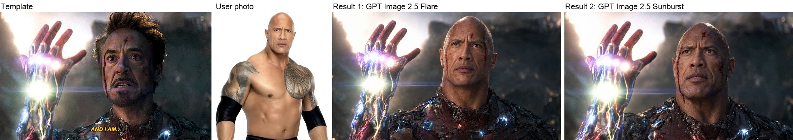
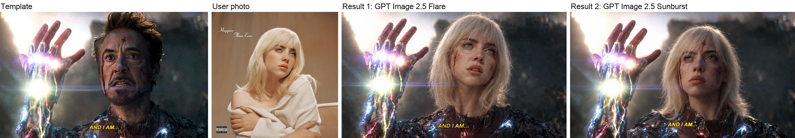
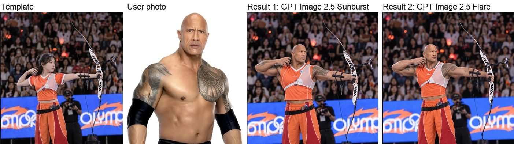
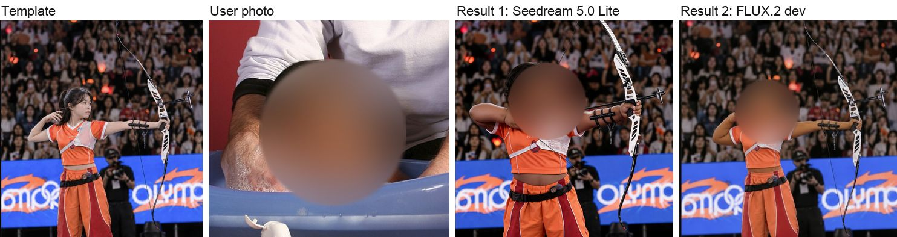
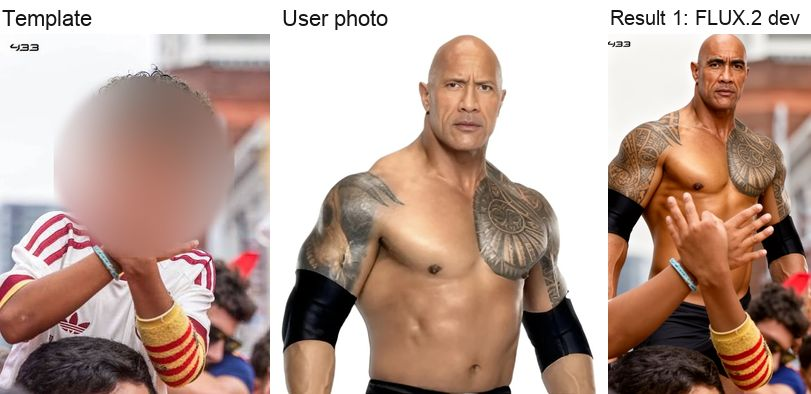

# Character Swap

Put a person from your own photos into a template photo, keeping the template's action, pose and scene.
Aurify take-home, photo track.

> **Status (2026-10-24):** the app is live on Vercel; the URL and the access code are sent separately. It ran 39 jobs
> between 2026-10-21 and 2026-10-23, and every case below was tested on 2026-10-24. Measured cost and time are in
> [Measured cost and time](#measured-cost-and-time); what does not work yet is in [Where it fails](#where-it-fails).

> **Prompts in this repository.** The prompt text here is a short generic version; the tuned prompt runs only on the
> live app. The results below were made with the tuned prompt, from the working copy of this code (the routing there
> also uses Qwen's age reading, see [Models](#models)). I can walk through the prompt in the interview.

## Results: the three cases

One set of photos, every direction the brief asks for, run through the full pipeline with `pnpm harness`
(2026-10-24). Each row shows the template, the user photo, and every version the app made, best first. The photos of
well-known people are test inputs only. The children's faces are blurred in this repository; the app saw them unblurred.

| Case | Template → user | Route | Verdict |
|---|---|---|---|
| 1 | Man → man | adult | **Pass.** The user's face; the raised hand, armour, cut and light kept. The anguished expression became calm. |
| 2 | Man → woman | adult | **Pass.** Her face and hair, a woman; armour and light kept. |
| 2 | Woman → man | adult | **Pass, both versions.** His face, build and tattoos at full draw; the uniform adapted to a man. |
| 3 | Adult → child | child | **Pass** (Seedream): a toddler at toddler size, in the uniform, at full draw. FLUX.2 dev lost the draw pose. |
| 3 | Child → adult (man) | child | **Not done.** See below. |

**Case 1, man → man.** 

**Case 2, man → woman.** 

**Case 2, woman → man.** 

**Case 3, adult → child.** 

**Case 3, child → adult: not done in time.** 

A child template goes to the child route, and both child-route models fell short here. Seedream 5.0 Lite refused the
user photo in both runs ("the output image may contain sensitive information"); the photo is shirtless. FLUX.2 dev
put the user's face and body in, but kept the boy's arms and dropped his jersey for the user's bare chest. With the
time I had and these two models, I could not make this case work. Next steps: a clothed user photo, and a third
child-route model.

**One rule I added to the brief's rules.** Child photos never go to OpenAI or Google models: both block edits of
realistic child photos by policy. So when any photo shows a child, both versions come from the child route, even for
an adult user on a child template. That route has no fallback model: a refused version stays refused.

## Run locally

Needs Node 20.9+ (the floor of Next 16) and pnpm.

The tests need no accounts. The app does: there is no offline mode. Before `pnpm dev`, create these and put their
values in `.env.local`:

| Setting | Where to get it |
|---|---|
| `ACCESS_CODE` | any code you choose; the first screen asks for it |
| `SESSION_SECRET` | 32 or more random characters, for example from `openssl rand -hex 32` |
| `DATABASE_URL` | a Neon Postgres database (free tier) |
| `BLOB_READ_WRITE_TOKEN` | a Vercel Blob store with **private** access |
| `MACHGEN_API_KEY` | MachGen, prepaid: about $0.12 per adult version |
| `XKIRO_API_KEY` | xKiro, free tier |
| `AWS_ACCESS_KEY_ID`, `AWS_SECRET_ACCESS_KEY` | an AWS user allowed to call Rekognition |

```sh
pnpm install
cp .env.example .env.local     # then fill in the values above
pnpm db:migrate                # once: creates the tables in your Neon database
pnpm photos                    # download the stock test photos listed in fixtures/photos/CREDITS.md
pnpm test                      # 220 tests, no network, no keys
pnpm dev                       # web app and API on http://localhost:3000
```

With only `ACCESS_CODE` and `SESSION_SECRET` set, the app opens and accepts the code, but the photo upload fails:
it needs the Blob store.

Test the pipeline without the web app:

```sh
pnpm calibrate                                    # Rekognition scores on known pairs → FACE_T
pnpm harness --mode record --max-spend 6          # all 6 cases, live calls, stops at $6
pnpm harness --mode replay                        # same run from the saved cache, $0
```

## Deploy

Vercel Hobby, Neon Postgres (compute capped at 0.25), private Vercel Blob, Vercel Workflow.
Step by step, with the checks to run after: `docs/deploy.md`.

## Architecture

```
 Browser / test script ──► Next.js API on Vercel
   1 POST /api/access        access code → signed cookie
   2 POST /api/upload        cookie → private Blob upload
   3 POST /api/jobs          job cap + spend cap → job row in Neon → start workflow
   4 GET  /api/jobs/:id      stage, ranked versions, scores, signed links (polled)
   5 POST /api/jobs/:id/rerun {problem: face|body|scene}  new job from the same photos

 Workflow (one step per function call, each under 300 s):
   prepare   Rekognition: faces, age, person box → reject bad photos, pick the route
   analyze   Qwen 3.8 Max (xKiro): identity kit (person) + scene card (template)
   generate  2 versions in parallel through MachGen (child route: Seedream 5.0 Lite + FLUX.2 dev)
   evaluate  Rekognition CompareFaces score + Qwen body and face-shape check per version
   retry     adult route only: 1 more version if the best score is under FACE_T
   repair    template face under 15% of image height → redraw the face crop, paste back
   finalize  rank every version (none hidden), save to Neon
```

Rejected designs are under **Tried or dropped** below.

**Web app.** One client screen (`app/_flow/`): access code, choose the moment (5 Pexels samples or your own
photo), add 1 to 4 photos of you, check and start, waiting, result. Photos upload straight from the browser to
private Blob. The job id sits in the URL (`?job=`), so the link brings the user back on any device. The result
shows every version at the same size, best first, with plain notes on what failed; scores and model names stay
hidden. Under each version, your face and the result's face sit side by side at the same size; press and hold a
version to see the moment it came from. A face finder runs in the browser (MediaPipe, on the device) to check each
photo as it uploads and to cut those close-ups. The rules behind the screens are in `src/ui/flow.ts` and
`src/ui/face.ts` and are unit tested. Design system: `DESIGN.md`.

## Models

| Role | Model | Why |
|---|---|---|
| Adult, version A | GPT Image 2.5 Flare (MachGen) | best ArcFace score in 6 of 6 paired spike runs vs Sunburst; 2× faster (44 to 48 s) |
| Adult, version B (a face rerun swaps A and B) | GPT Image 2.5 Sunburst (MachGen) | the owner's favourite face shape once (run #8); very stable with fixed text |
| Child route, version A | Seedream 5.0 Lite (ByteDance, partner-hosted on MachGen) | not OpenAI or Google; $0.038 per image flat; up to 14 inputs. Refused 8 of 12 child versions on the live app |
| Child route, version B | FLUX.2 dev (open model, on MachGen's own GPUs) | $0.004 per output MP: $0.003 to $0.007 at the sizes used (1024x768, 1024x1024, 1024x1808). Up to 3 inputs (template + 2 photos). 0 refusals in 14 live versions, median 10 s |
| Photo gate, age, likeness score | AWS Rekognition | $0.001 per image, 0–100 face score |
| Identity kit, scene mood, body and face-shape check | Qwen 3.8 Max on xKiro (`qwen/qwen3.8-max:free`; backups Qwen3 VL Plus, qwen3.7-flash, qwen3.5-omni-flash on 429/503) | free tier, 6 to 13 s per call. Gemini dropped: its key hit quota (429) |

**Child photos never go to OpenAI or Google.** Both block edits of realistic child photos by written policy, so the
route is chosen from the youngest face Rekognition finds in any photo. In the working copy, Qwen's age reading of the
template and the user also counts. No fallbacks: a refused child version stays refused.

**Where child photos go.** Seedream 5.0 Lite is partner-hosted: MachGen passes the photos through to ByteDance.
Only FLUX.2 dev keeps the photos on MachGen's own GPUs. The FLUX.2 dev weights carry a non-commercial license;
check MachGen's terms before commercial use.

**Tried or dropped**

- **fal.ai:** dropped by the owner on 2026-10-21. MachGen sells the adult models and was already paid for.
- **GPT Image 2:** dropped. ArcFace scored it well, but the owner rejected its faces by eye.
- **Nano Banana Pro / 2:** weakest published face scores, and it blocks children.
- **Generated angle views as extra references:** dropped. The model would not turn the head, and the face drifted.
- **Face lock** (a face-swap model after generation): dropped in design v2. It replaces only the inner face, so
  the template person's head and hair stay; the common model works at 128 px and has a non-commercial license.
- **Covering the template face:** dropped in design v2. It removes the light, head-angle and expression cues.

## Measured cost and time

**The live app** (job records, 39 jobs on Vercel, 2026-10-21 to 2026-10-23, 24 finished). Time runs from job start to
the last saved version, so it includes queueing, photo checks and vision calls. Cost is every paid call booked for the job.

| Route | Finished jobs | Time per result, median (range) | Cost per result, median (range) |
|---|---|---|---|
| Adult: 2 GPT Image 2.5 versions, sometimes 1 retry | 13 of 28 | 145 s (101–244 s) | $0.29 ($0.20–$0.54) |
| Child: Seedream 5.0 Lite + FLUX.2 dev | 11 of 11 | 88 s (80–165 s) | $0.06 ($0.06–$0.10) |

| Call | Calls | Time: 90th percentile (max) | Cost per call | Refused versions |
|---|---|---|---|---|
| GPT Image 2.5 Flare | 42 | 62 s (72 s) | $0.12, up to $0.14 | 8 of 44 |
| GPT Image 2.5 Sunburst | 33 | 110 s (118 s) | $0.12, up to $0.21 | 5 of 35 |
| Seedream 5.0 Lite | 12 | 50 s (70 s) | $0.04 | 8 of 12 |
| FLUX.2 dev | 14 | 35 s (87 s); median 10 s | $0.01–$0.02 | 0 of 14 |
| Qwen vision (identity, scene, body check) | 122 | 13 s (32 s); median 8.7 s | $0, free tier | |
| Rekognition | 164 | 3.5 s (5.7 s); median 1.1 s | $0.001 per image | |

**The case test above** (local, 2026-10-24): 73–352 s and $0.06–$0.43 per case. The app books MachGen's gross price;
MachGen's own usage report showed it charged less ($0.66 against $0.85 booked on the first run) and refunded failed tasks.

**Earlier single-swap tests** at 1280×848: Flare 45–66 s, Sunburst 84–123 s, $0.118 per image (gross).

## Where it fails

1. **Child template with an adult user (case 3).** Not done in time: Seedream refuses, FLUX.2 dev keeps parts of the
   child (see Results).
2. **Adult jobs failed often on the live app:** 15 of 28. 11 were provider errors, most when the MachGen wallet ran
   empty; the app now moves to the next MachGen key when one runs out. 4 were refused by both models.
3. **Routing rests on age guesses.** With Rekognition on, it guessed an adult archer at 15–21 and the job took the
   child route; the low end of the range decided. Rekognition is off on the live app, so the route rests on Qwen.
4. **The likeness score cannot rank results.** Rekognition scored almost every version 99.8–100; it caught only a
   total failure (4.6). On the live app it is off, so every version gets the same fixed score.
5. **The body check is not reliable.** Qwen sometimes judges backwards: it failed a correct version for "keeping the
   real person instead of adopting the template". Its free tier was also busy at times, so some versions had no check.
6. **The expression is not always kept.** In case 1 the template's anguished face became calm.
7. **Most test users are well-known people.** Image models may already know these faces. My own face, which the
   models do not know, scored 0.57–0.59 on a local face model against 0.80–0.85 for well-known faces.
8. **Face repair adds artifacts.** It pasted a small copy of the user's photo into one result and an extra face into
   another. The working copy now skips it by default; this snapshot still runs it.
9. **Most cases have 1 run.** Image models give a different result each time.

## Repository

| Path | What |
|---|---|
| `src/` | pipeline, providers, database, server helpers, workflow |
| `app/api/` | API routes |
| `scripts/` | harness, calibration, smoke test, photo fetch |
| `fixtures/` | test cases and photo credits (photos are fetched, not committed) |
| `docs/` | deploy notes |
| `results/` | the case test images shown above |

## How I use AI

I built this with an AI coding agent (Claude Code). The agent writes most of the code. I set the direction, check
the work and make every product and model decision.

1. **Design first.** For each feature I describe the goal. The agent asks questions, then writes a short design
   document. I approve it before any code is written.
2. **Plan.** The agent turns the design into small steps, each with its own tests.
3. **Tests first.** For each step the agent writes a failing test, then the code that makes it pass.
4. **Review.** A second agent reviews the change for bugs. A third reviews the screens from screenshots at 1440,
   1024 and 390 px wide. I read their findings and choose what to fix.
5. **Design system.** An AI design tool helped me write `DESIGN.md` and `PRODUCT.md`. I picked the direction from
   mockups it built.
6. **Likeness tuning.** The agent ran the spike tool for me: one swap per prompt or model change, scored with ArcFace.
   I judged every face by eye. Where my eye and the score disagreed, my eye won (see [Where it fails](#where-it-fails)).

The agent's working files (design documents, plans, review reports, its tool settings) are not in this repository.

